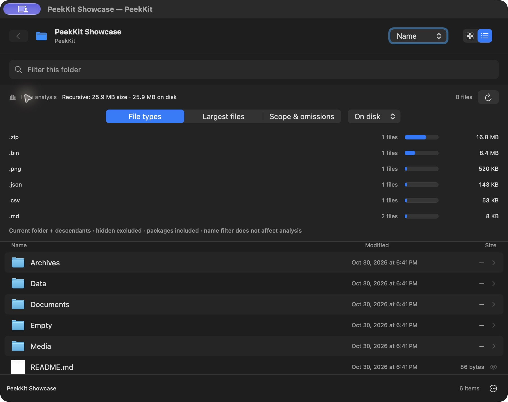
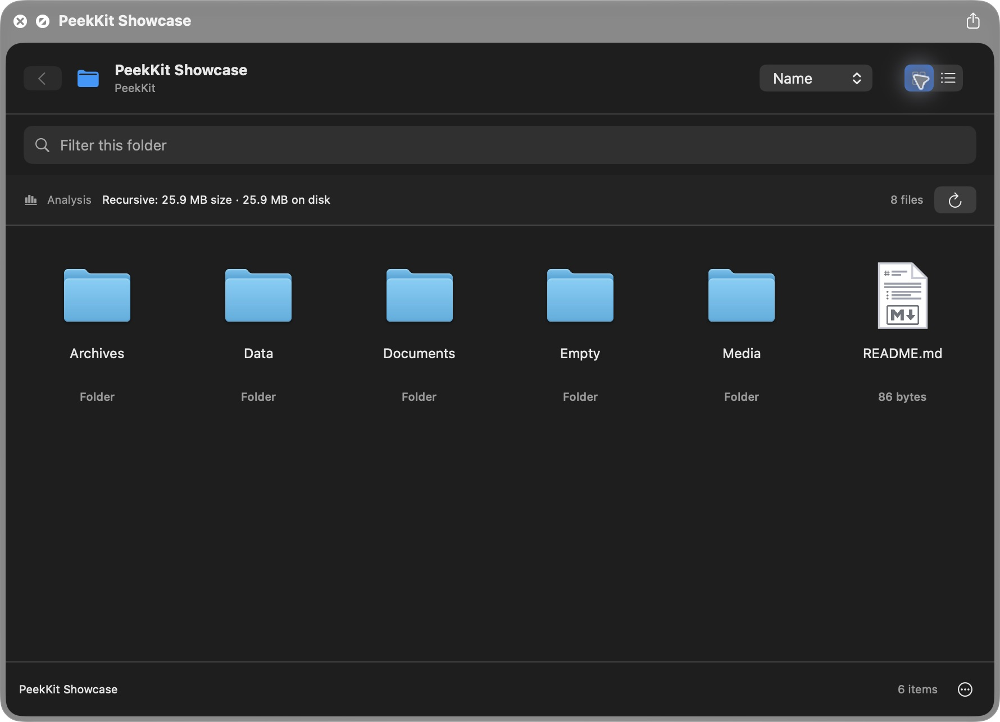
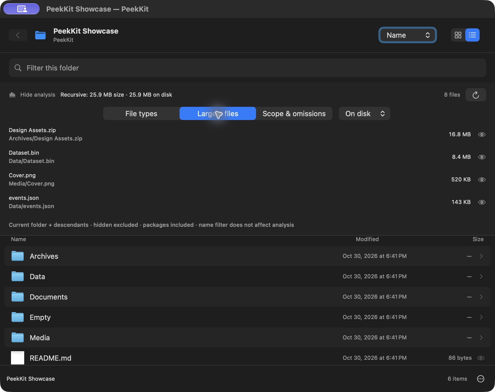
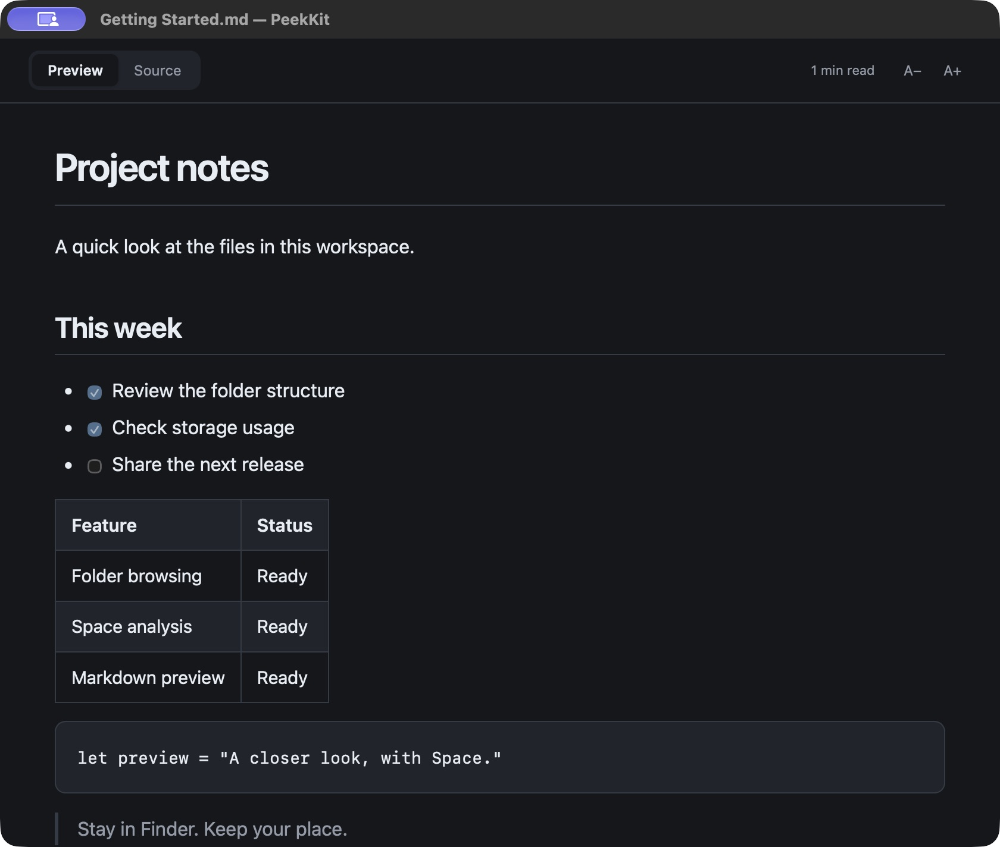

# PeekKit

**A closer look, with Space.**

Browse folders, understand what takes up space, and read Markdown without leaving Finder.

[简体中文](README.zh-CN.md) · [Installation](docs/INSTALL.md) · [Build from source](docs/BUILDING.md) · [Analysis details](docs/ANALYSIS.md)



## New in 1.2.0

- Expand a bounded folder tree; filter loaded names without rescanning disk. Lists include file type, size and modification date.
- Navigate with arrow keys and Return; use ⌘[ for Back, ⌘F for filtering, ⌘R for refresh, and ⇧⌘. for hidden files.
- Context actions: Reveal in Finder, Copy Path, Open in Default App and Open With.
- Compare largest files **and nested folders**, see storage shares, and copy an analysis summary as JSON or spreadsheet-safe CSV.
- Shared offline Markdown rendering with bounded lexical code highlighting, improved tables/quotes and clickable contents in HTML previews.
- Worker-based sorting, reading and decoding; stale-result protection and metadata-aware thumbnail caching.

[Detailed changes](CHANGELOG.md) · [Architecture](docs/BUILDING.md) · [Keyboard and limitations](docs/UPGRADE-1.2.md)

## What it does

- Browse folders in a grid, list or lazily expanded tree, enter subfolders, sort by name/date/size/type, filter names, and show hidden files.
- Measure recursive logical size and allocated file blocks in the background, with progress and Stop/Rescan controls.
- See file counts and capacity by extension, plus the 20 largest files under either size metric. Open a preview or reveal a result in Finder.
- Preview images, PDFs, text and Markdown inside the folder browser. Open Markdown directly with Finder Quick Look, including headings, tables, code and checklists.
- Keep the main app closed during normal Finder use. Markdown assets are bundled locally; the preview extensions have no network entitlement.

## Screenshots

| Browse a folder | Find large files |
| --- | --- |
|  |  |



The screenshots above document 1.1.0. New 1.2.0 screenshots and validation notes are in [the upgrade guide](docs/UPGRADE-1.2.md). Actual application screenshots use synthetic sample data. The grid is Finder Quick Look; analysis and Markdown images use the standalone preview window. No personal folders are shown.

## Get started

Requires **Apple Silicon and macOS 14 or later**. For this source release, build locally using Xcode, move the resulting app to Applications, then enable **PeekKit Folder** and **PeekKit Markdown** in Quick Look extensions.

```sh
git clone https://github.com/LujiaChen/PeekKit.git
cd PeekKit
./build.sh
```

The app is written to `.build/PeekKit.app`. The default build uses ad-hoc signing. A Developer ID–signed, notarized download is not provided in this source release; installation/extension behavior on another Mac still needs validation. [Installation and troubleshooting →](docs/INSTALL.md)

In Finder, select a folder or Markdown file and press **Space**. Click **Analysis** to expand file types, largest files, and scope details.

## What a size means

**Size** is the logical length of measured files. **On disk** is their allocated block count, not exclusive or reclaimable APFS space. Analysis includes the current folder, descendants and application-package contents. Hidden files follow the browser toggle; name filtering does not change the totals.

Symbolic links are not followed, hard links are counted once, and other volumes and cloud-only entries are skipped. Permission failures and scan limits produce explicitly partial results with omission counts and sample paths. Analysis reads metadata and does not request cloud downloads. [Full definitions and limits →](docs/ANALYSIS.md)

## Validation

The current local build passed **28 scanner/model checks** and **22 renderer checks**, plus interactive Finder checks for browsing and previews. A 25,000-file directory completed in about 4.8 seconds through the installed Quick Look extension on the development Mac. This is an observation, not a performance guarantee.

Real cloud placeholders, network/cross-volume mounts, Intel and other macOS versions have not been integration-tested. GitHub Actions also built this release and passed the scanner/model tests on macOS arm64. [CI result](https://github.com/LujiaChen/PeekKit/actions/runs/41142241480). [Test scope and reproduction →](docs/TESTING.md)

## Development

```sh
./Tests/run.sh
```

Swift / SwiftUI / AppKit, two native Quick Look extensions, no package-manager dependencies. [Architecture and build details →](docs/BUILDING.md)

## License and acknowledgments

[MIT](LICENSE) for PeekKit's original source. Marked and DOMPurify are bundled with their notices. [PeekX](https://github.com/altic-dev/PeekX) was a functional reference for folder analysis, which is independently implemented. See [third-party notices](THIRD_PARTY_NOTICES.md).
