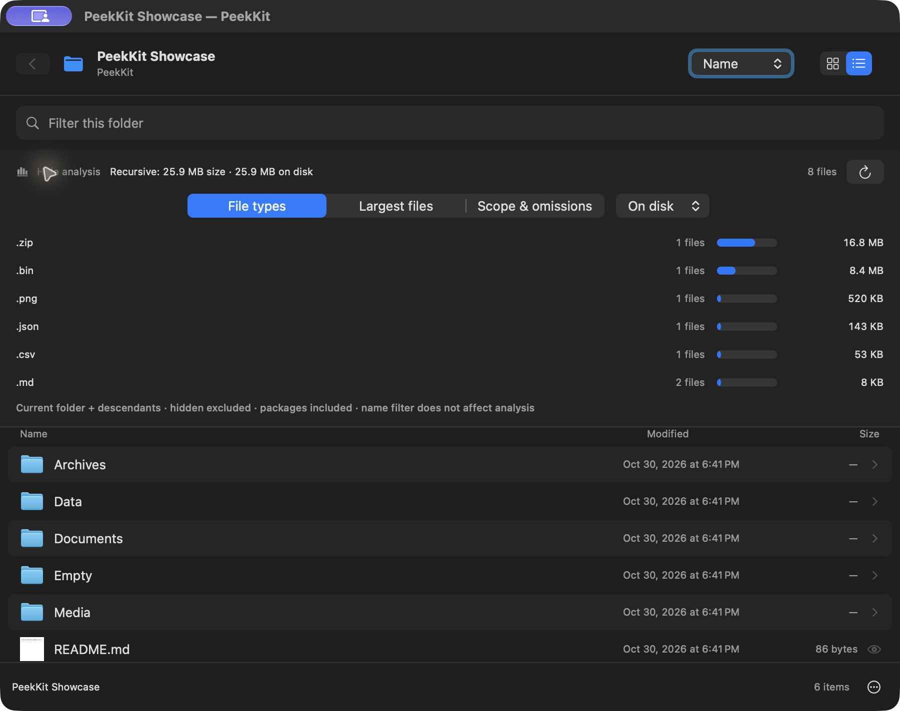
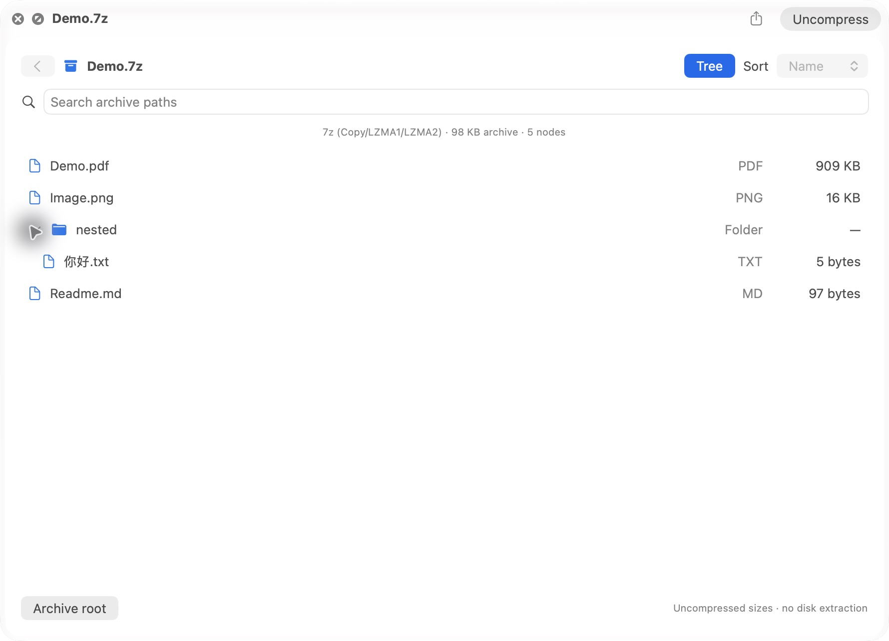
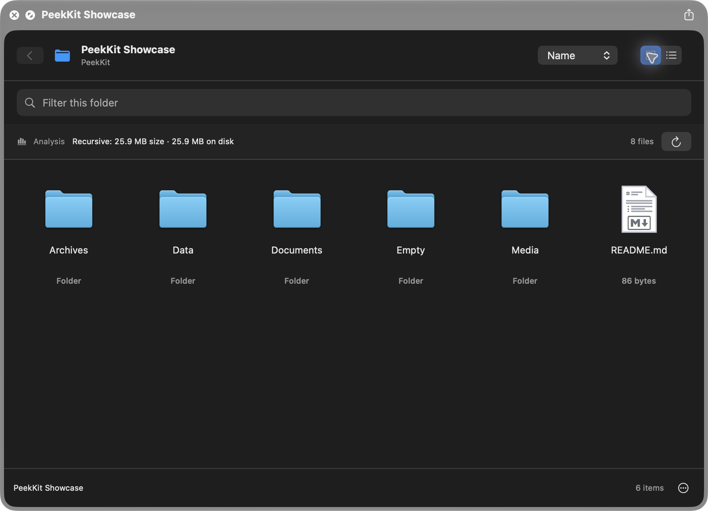
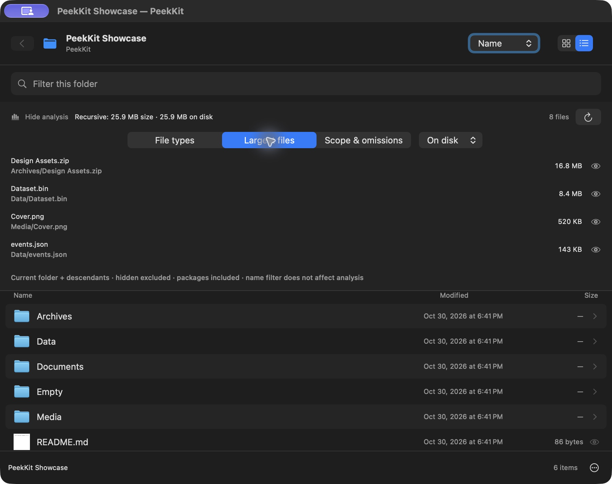
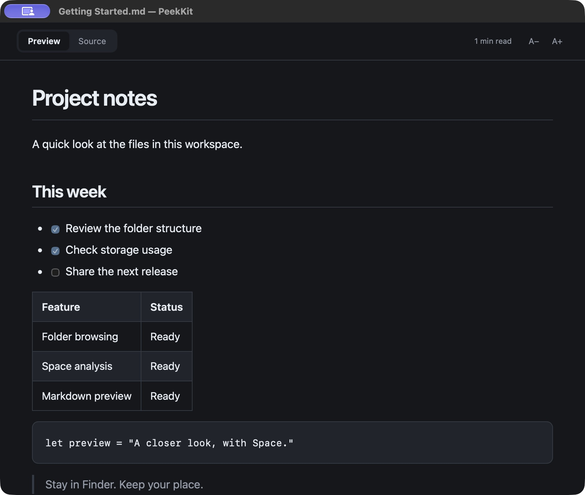

# PeekKit

**选中，按空格，预览。**

在 Finder 中浏览文件夹、了解空间占用、阅读 Markdown。

[English](README.md) · [安装说明](docs/INSTALL.md) · [构建说明](docs/BUILDING.md)



## 1.3.3 — 可直接下载应用安装包

在 [v1.3.3 Release](https://github.com/LujiaChen/PeekKit/releases/tag/v1.3.3) 下载 Apple Silicon ZIP 或 DMG，
无需 Xcode。核对校验值、拖入“应用程序”后运行随包附带的安装工具，详见[安装步骤与信任说明](docs/INSTALL.md)。
应用使用临时签名，未经 Apple 公证。本次更新打包及安装流程，保留 1.3.2 的应用功能和修复。

## 1.3.2 — Markdown 与 PDF 稳定性修复

- 修复文件夹 Markdown 排版、连续表格边框、中文换行，以及亮暗外观的正文颜色。
- PDF 改用 Finder 中可操作的原生页码菜单，保留文件支持、连续滚动和缩放。
- 修复原生视图载入前取消预览时的文件句柄保留，增加重复关闭和更新的回归检查。
- 图片密集的大 PDF 仍可能让 PDFKit 短时占用较多内存和 CPU；三轮测量在退出 PDF 后均明显回落，不代表存在硬资源上限。[性能与验证记录](docs/VALIDATION-1.3.2.md)。

## 1.3.1 — 大 PDF 与安全 7z 浏览

- 本地 PDF 改用文件支持的 PDFKit 阅读器，按需显示页面，支持连续滚动、缩放、页码跳转与总页数；移除原来的 50 MB 图标回退，没有提高整文件内存读取上限。
- 新增 7z Copy/LZMA1/LZMA2 浏览，支持有界固实块与压缩头；字典最多 8 MiB，拒绝加密、多编码器链、不安全路径及超限输入。
- [PDF 实现](docs/PDF.md) · [格式与安全限制](docs/ARCHIVES.md) · [本次验证](docs/VALIDATION-1.3.1.md)。



## 1.3.0 正式源码版

- 新增 ZIP（存储/Deflate）、TAR、TGZ、TBZ2 树形和目录浏览、路径搜索，以及离线文本、图片、PDF 和有界 Markdown 预览。
- 压缩流先在输出预算内展开，再预检 TAR/ZIP 头部；1.3.0 禁用 XZ、7z、RAR；1.3.1 新增受限的 7z 子集。协作式时间限制不等于硬 CPU/RSS 上限。
- 信息面板增加图片尺寸、PDF 页数、类型、权限和日期；列表可配置逻辑大小、分配块、创建/访问日期等列，使用后台缓存元数据。
- [支持矩阵与安全边界](docs/ARCHIVES.md) · [测试、测量与真实截图](docs/VALIDATION-1.3.md)。

## 1.2.0 更新

- 新增按需展开的树形视图，列表增加类型列，支持名称、大小、日期、类型排序。
- 聚焦浏览区域后用方向键和 Return 浏览；Quick Look 宿主可能截获命令快捷键，可用可见按钮操作。⌘[ 返回，⌘F 筛选，⌘R 刷新，⇧⌘. 切换隐藏文件。
- 右键可定位到 Finder、复制路径、用默认应用打开或选择应用。
- 新增大文件夹排名、容量比例图，支持复制 JSON 和防公式注入的 CSV 摘要。
- Markdown 统一安全渲染，增加有大小上限的词法代码高亮，改善表格及引用，HTML 预览支持可点击目录。
- 排序、读取、解码放到后台；加强导航、取消及缩略图缓存管理。

[更新详情、键盘及限制](docs/UPGRADE-1.2.md)

## 功能

- 文件夹网格和列表视图、子目录浏览、名称/日期/大小排序、名称筛选及隐藏文件开关。
- 后台递归统计逻辑大小和磁盘分配大小，逐步显示结果，可停止和重新扫描。
- 按扩展名显示文件数量和容量；列出两种大小口径各自的前 20 个文件，支持预览和在 Finder 中定位。
- 文件夹内预览图片、PDF、文本和 Markdown；也可直接选中 Markdown 按空格，查看标题、表格、代码、任务列表及原文。
- 日常 Finder 预览无需主应用常驻。Markdown 资源本地提供，预览扩展没有网络权限。

| 浏览文件夹 | 定位大文件 |
| --- | --- |
|  |  |



上方截图记录 1.1.0，1.2.0 新界面见[升级说明](docs/UPGRADE-1.2.md)。以上为真实应用截图，使用专门制作的示例文件。网格图来自 Finder Quick Look，分析和 Markdown 图来自独立预览窗口，没有展示私人文件夹。

## 安装

要求 **Apple Silicon、macOS 14 或更新版本**。

**预编译安装包（对应 Release 提供时推荐）：** 从 [Releases](https://github.com/LujiaChen/PeekKit/releases)
下载 `PeekKit-<版本>-arm64-adhoc.zip` 或 `.dmg` 及同次发布的 `SHA256SUMS.txt`。
核对 SHA-256 后，将 **PeekKit.app** 拖入“应用程序”。在解压目录或挂载磁盘中打开终端，运行：

```sh
bash ./install-app.sh --allow-quarantine-removal
```

这个参数表示你已核对并决定信任下载。工具先检查签名、版本和两项扩展的沙盒权限，再仅清除
PeekKit 的隔离标记，保留其他扩展属性；随后注册扩展、刷新 Quick Look。打开 PeekKit 一次，
在系统设置中启用 **PeekKit Folder** 与 **PeekKit Markdown**。一般无需重签，排障时可加
`--resign`，按扩展、主程序的顺序签名并保留权限。

安装包是**临时签名（ad-hoc），没有 Developer ID 签名或 Apple 公证**。移除隔离标记是对本应用
的信任决定，不代表 Apple 审核或保证每台 Mac 都能启用。不会关闭系统级安全保护。
[完整安装、校验与排障步骤](docs/INSTALL.md)。

**源码构建：** 需要 Xcode，无需付费开发者账户或额外下载依赖。

```sh
git clone https://github.com/LujiaChen/PeekKit.git
cd PeekKit
./build.sh
```

将 `.build/PeekKit.app` 放入“应用程序”，打开一次并启用两项扩展。旧的纯源码 Release 保持不变；
新的[标签发布工作流](.github/workflows/release.yml)为后续版本生成 ZIP、DMG、源码 ZIP 和校验文件，
不会自动改写旧版 Release。在 Finder 选中文件夹或 Markdown，按空格；点击 **Analysis** 展开统计。

## 统计范围与限制

统计当前目录及后代，包括应用包内部。隐藏文件跟随开关，名称筛选不改变总量。Size 是文件逻辑长度；On disk 是分配给文件的磁盘块，不等于 APFS 独占或删除后可回收空间。

不跟随符号链接；硬链接只计一次；跳过其他卷、云端未下载或无法确认驻留状态的项目。只为统计读取元数据，不请求云文件下载。权限不足、主动停止或达到上限时，明确显示部分结果及遗漏说明。

上限为 100 万条目、128 层、60 秒；浏览列表保留 20,000 项显示上限，分析统计独立进行。详见[统计定义](docs/ANALYSIS.md)。

## 测试

1.2 已通过 102 项检查：28 项分析、26 项浏览/预览、20 项内容/导出安全、28 项渲染/生命周期测试。手动检查覆盖已安装扩展的系统 Quick Look 宿主，以及独立窗口的浅色和深色界面。本次 Finder 空格键操作因自动化窗口连接问题未能完整验证。25,000 个文件的单次本地扫描测量为修改前 1.095 秒、修改后 0.949 秒，不代表统计意义上的性能提升。[测量及验证边界](docs/UPGRADE-1.2.md)

真实云端占位文件、网络及跨卷挂载、Intel 和其他 macOS 版本尚未完整实测。GitHub Actions 已在 macOS arm64 上构建主程序和两个扩展，并通过全部四组测试。[CI 结果](https://github.com/LujiaChen/PeekKit/actions/workflows/ci.yml)。[测试说明](docs/TESTING.md)

## 许可证与致谢

PeekKit 原创源码使用 [MIT](LICENSE)。Marked、DOMPurify 保留原有许可和署名。文件夹分析以 [PeekX](https://github.com/altic-dev/PeekX) 为功能参考，独立实现；详见[第三方说明](THIRD_PARTY_NOTICES.md)。
