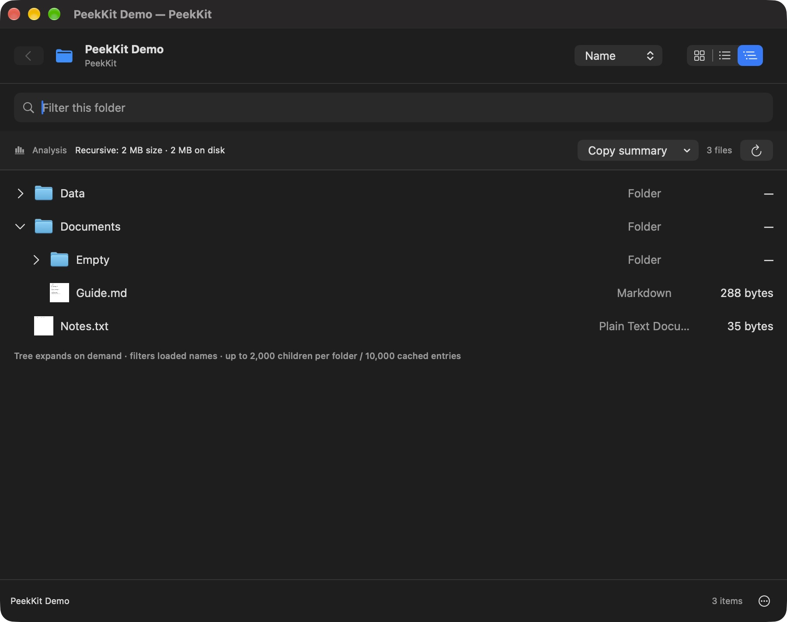
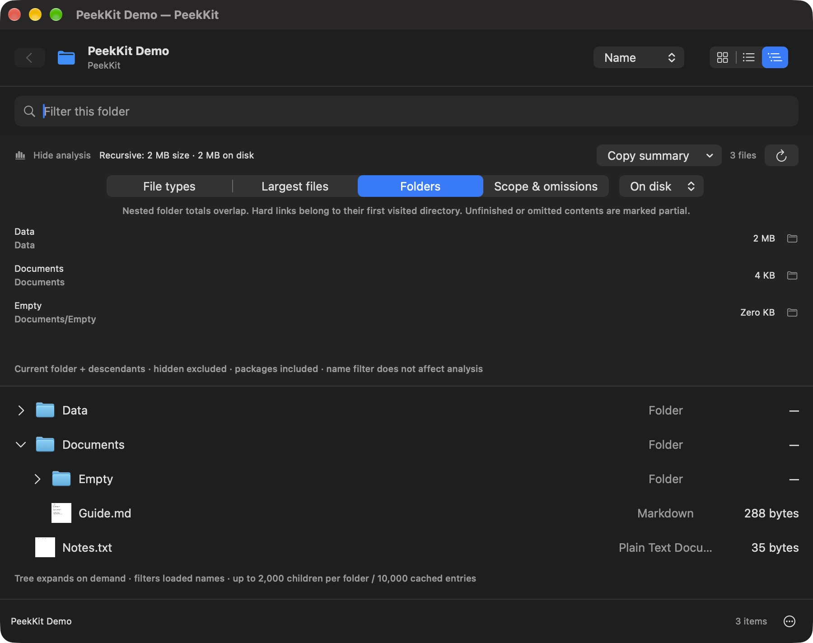
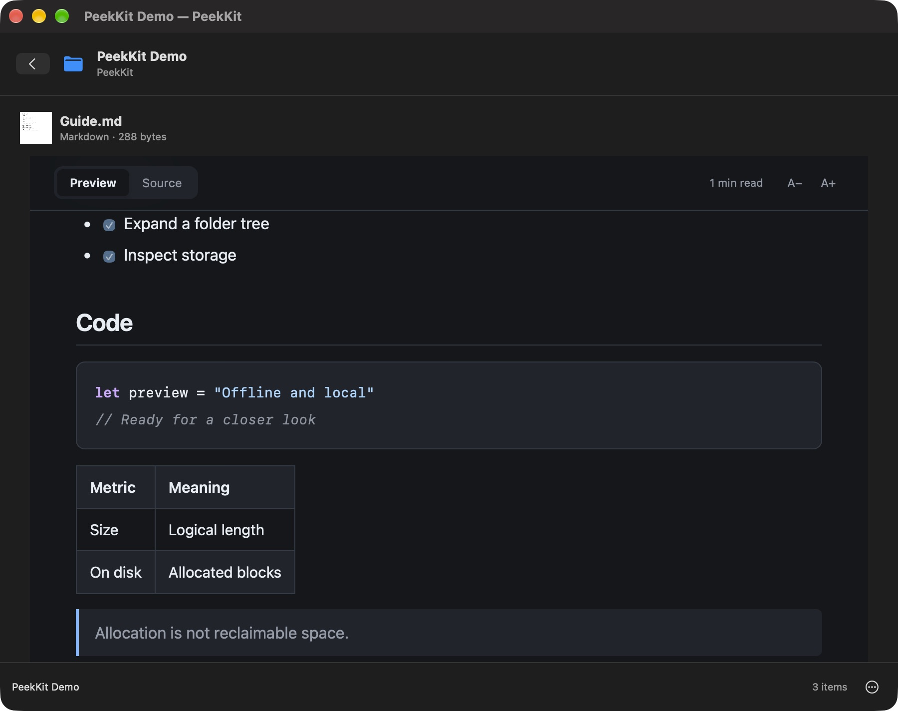

# PeekKit 1.2.0

This release adds a lazy tree, typed lists, background presentation, recursive folder rankings, analysis copy and shared secure Markdown rendering. Apple Silicon/macOS 14+; source builds remain the supported public installation route.

## Actual interface

These are actual 1.2 development-build screenshots using synthetic files in the standalone reader. The copy menu is now a compact document icon; some screenshots were taken before that final spacing adjustment. Prior 1.1 screenshots remain labeled as historical in the README.

## Browsing and keyboard

Grid, list and tree are alternate presentations of the current directory. Tree children load only when expanded; searching filters loaded names and retains ancestor context. It does not start another analysis scan or recursively search unopened folders.

| Action | Shortcut |
| --- | --- |
| Focus filename filter | ⌘F |
| Refresh listing and analysis | ⌘R |
| Back from preview / parent within root | ⌘[ |
| Show hidden entries | ⇧⌘. |
| Move selection in focused browser area | Up / Down |
| Expand / enter, collapse / back | Right / Left |
| Open focused entry | Return |

Command shortcuts depend on the hosting window. In the system QLPreviewView test host, ⌘[ was consumed before the extension could act; use the visible Back button there. The model-level arrow/Return behavior is covered automatically; full keyboard delivery through every Finder host is not guaranteed.

Click disclosure arrows to expand without changing the current directory; click a folder's name to enter it. Context menus offer Reveal in Finder, Copy Path, Open in Default App and Open With. Open With uses the native application chooser. View and sort preferences persist locally; search text and hidden scope reset with a new browser session.

Tree bounds: 2,000 immediate children per expansion, 10,000 cached child entries, 64 levels. The main browser still lists up to 20,000 immediate entries. Limits are shown with directions to open a subfolder. Tree state is cleared on navigation, hidden-scope changes and refresh. Cancelled expansion results cannot populate a replacement directory.

## Analysis and clipboard privacy

Folders are accumulated postorder using the existing open directory stack, with no second filesystem traversal and no content reads. Top 20 nested directories are retained independently for Size and On disk. Ancestor/descendant totals overlap and must not be summed. Hard-link bytes are assigned to the first visited directory; ranking can therefore depend on traversal order for shared hard links. Partially visited/omitted scopes are labeled.

The document-copy menu copies JSON or CSV. Both include scope, state, totals, omission counters, sample issues, largest files/folders and both size metrics; JSON has schemaVersion 1. CSV quotes fields and prefixes spreadsheet formula-like text with an apostrophe. Copying is explicit and includes paths: review the result before sharing. No export file is written by the extension, and no write/network entitlement was added.

The original scanner's symlink/device, sparse-file, hard-link, cloud residency, permission, overflow, depth/time/entry, cancellation and descriptor-cleanup behavior is preserved. Allocation remains file blocks, not exclusive/reclaimable space. The strip shows the largest eight type buckets; all buckets remain in the rows.

## Markdown architecture and security

- Markdown reads use bounded no-follow, nonblocking regular-file handles; cloud-only and unknown-residency metadata is rejected conservatively.
- All three paths use the same JavaScriptCore-generated body. Raw document HTML is escaped. Links allow only http/https/mailto/fragments; images only allowed raster data URIs. Remote/file resources remain blocked.
- Standalone WebKit additionally sanitizes that body with bundled DOMPurify and uses a nonce CSP for app-owned UI code. Direct Markdown Quick Look stays script-free.
- HTML previews include up to 100 table-of-contents links, duplicate-safe anchors and bounded lexical highlighting for Swift, JavaScript/TypeScript, JSON, Python, shell, C/C++ and CSS. This is lexical coloring, not a complete language grammar. Unknown/over-64-KB code blocks render escaped without highlighting.
- The folder extension retains native attributed text. HTML fragment navigation is not supported there, so its nonfunctional TOC is omitted. Native formatted conversion is capped at 128 KB; Source remains available up to the existing 8 MB document limit. Tables, code text and escaped HTML share the common renderer, while native typography/coloring can differ.
- Native external links are protocol-filtered; source/preview changes avoid resetting unchanged text storage. WebKit source tabs retain scroll positions and support left/right keys.
- Mermaid and KaTeX are not included; introducing additional executable parsing dependencies was deferred. No third-party library was added.

## Reproducible measurements

Reports: [old scanner baseline](validation/1.2/baseline-analysis.json), [new scanner](validation/1.2/analysis.json), [browser](validation/1.2/browser.json).

| Measurement | Baseline | 1.2 |
| --- | --- | --- |
| Isolated 25,000-file scan, one local run | 1.095 s | 0.949 s |
| Maximum main-actor heartbeat delay during model scan | 12.55 ms | 12.55 ms |
| 20 reads of a 20,000-entry name ordering | 76.627 ms, re-sorting each time | 0.0051 ms, cached reads |

The presentation microbenchmark excludes the initial background sort and SwiftUI painting. It demonstrates eliminated repeated sorting, not a claim of an equivalent end-to-end speedup. Scanner timings are single runs on a warm local filesystem, not statistical speedup evidence. Run Tests/browser.sh to reproduce the presentation comparison and Tests/run.sh for the scanner. RSS of the whole app was not benchmarked; the thumbnail cache uses an approximate 32 MB cost budget and 300-item limit. In-flight filesystem or decoder work cannot be forcibly preempted; cancellation rejects its result.

## Validation and remaining limits

Local suites: **28 analysis + 26 browser + 20 content/export + 28 renderer/lifecycle checks = 102 passing checks**. The original 28 analysis and 22 renderer checks remain; the heading-markup assertion now verifies the new generated heading ID as well. New URL-fragment tests decode percent-encoded Unicode anchors before finding targets.

The locally development-signed 1.2.0 app and both extensions passed strict signature verification. The installed extension was exercised through the system QLPreviewView host: tree expansion, native Markdown Preview/Source and folder browsing worked. The previous installed 1.1 application and a byte-verified ZIP were preserved before replacement.

Manual standalone checks covered tree expansion/collapse/filtering, visible ancestor context, folder ranks, contents expansion/jump, highlighted code, tables, source controls and light/dark appearances. Finder Space-bar verification of this update was limited by an unavailable Finder UI window; the installed extension itself was tested through the system Quick Look host. UI screenshot automation is not an accessibility audit.

Real cloud providers, network/cross-volume mounts, very slow providers, million-entry trees, Intel and clean-machine installation remain unverified. Tests cover policy and bounded synthetic cases. Data can change during a live scan; permissions can change between metadata and a framework's later access. Open With/Reveal can be constrained by Quick Look's system sandbox and destination app behavior.

## Build and distribution

./build.sh still defaults to ad-hoc local signing. PEEKKIT_SIGN_IDENTITY can name an available identity; Developer ID Application identities additionally enable hardened runtime and timestamping. Tools/package.sh requires an existing notarytool keychain profile in PEEKKIT_NOTARY_PROFILE, verifies Developer ID/runtime, submits for notarization, staples, validates and assesses before producing a named notarized ZIP. No credentials are stored in source. This optional production path has not been exercised here because no Developer ID certificate/notary profile is available.

The public release is explicitly a source preview. Locally validated development-signed app builds are not presented as notarized production downloads. An old local installed version is backed up before any replacement.
