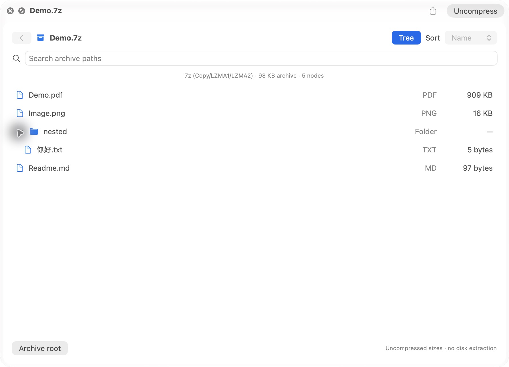
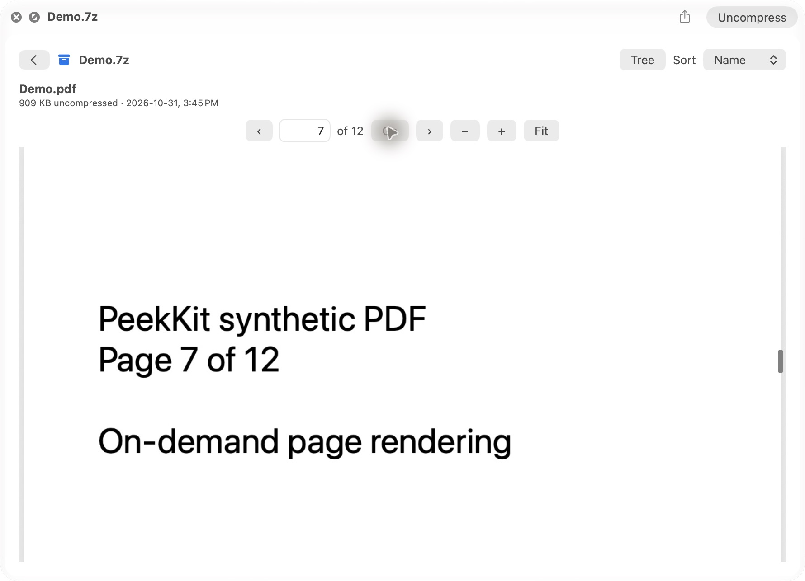
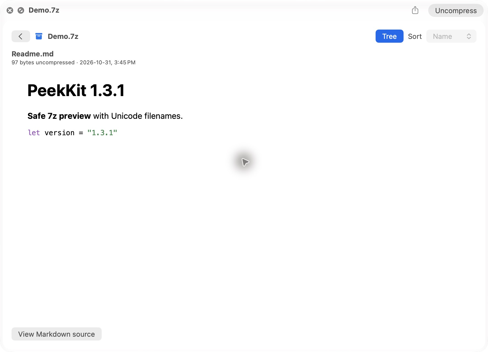
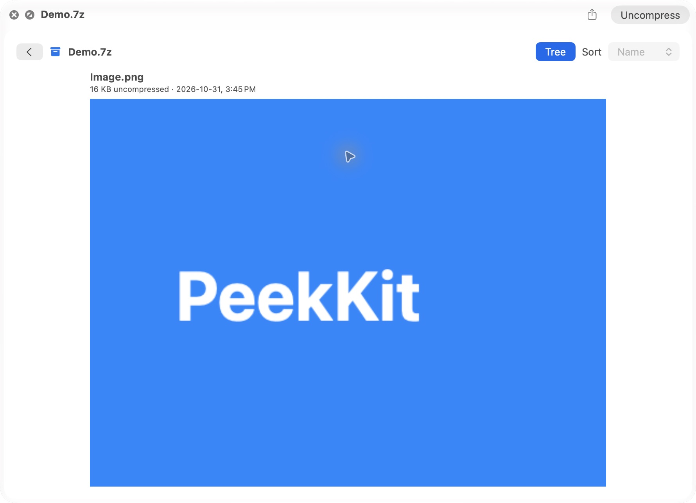

# PeekKit 1.3.1 (build 7) validation

Environment: Apple M5, 10 logical processors, macOS 27.2 (26B123); target Apple Silicon/macOS 14+. Other machines/OS versions and Intel are not integration claims. Default local build uses ad-hoc signing, not Developer ID or notarization.

## Reproducible automated verification

A clean clone at b3f9433 ran all seven suites and built the host and both Quick Look extensions. **218 passed / 0 failed**: analysis 28, archive 79, browser/inspector/ordering 35, content/export/security 20, renderer/lifecycle 28, PDF 17, registration 11. Later release changes are documentation/evidence only.

Reports are in [validation/1.3.1](validation/1.3.1). Run:

```sh
./Tests/registration.sh
./Tests/run.sh
./Tests/archive.sh
./Tests/pdf.sh
./Tests/browser.sh
./build.sh
./Tests/content.sh
./Tools/test-renderer.sh
```

All prior suites are retained. New cases include plain/encoded 7z headers, Copy/LZMA1/LZMA2 and solid streams, official synthetic 7-Zip 26.05 output, Unicode, invalid/truncated/checksum-corrupt headers/data, traversal, conflicting paths, links/reparse metadata, dictionary/header-dictionary caps, deceptive decoded sizes, oversized entries/metadata/counts/integers and cancellation. No 7-Zip executable is required by CI/build/runtime. Fixture provenance and hashes are in Tests/fixtures.

PDF tests create a valid sparse 87,027,883-byte/40-page incremental PDF and exercise page navigation/clamping, zoom, document switching, teardown, missing/unreadable/locked/corrupt files, symlink replacement, cancellation and descriptor release. The cleanup test specifically observes the session's owned descriptor/inode and weak lifetime, rather than assuming every process descriptor belongs to PeekKit: native AppKit/PDFKit may open unrelated resources asynchronously. An earlier process-wide-count assumption failed on CI and was replaced with this scoped resource assertion. Encrypted multi-coder archives are rejected with an explicit unsupported/encrypted explanation.

## Real Finder verification

Actual Space-bar Quick Look, with the main app closed:

- Private resident **86,264,556-byte, 712-page PDF** through School → its existing subfolders → file: pages rendered, Previous/Next, zoom, continuous scroll, Go to page 100 and scroll to 101, file switching and close/reopen succeeded. No textbook bytes, screenshots or personal paths are committed; public PDF screenshots use authored samples.
- 7z registered through the existing Folder extension: actual browser, tree expansion/Unicode text, directory navigation, search, sorting, image, PDF and formatted Markdown/source toggle checked. Official Copy/LZMA1/LZMA2 fixtures opened. High-memory dictionary and encrypted fixtures showed errors, and later valid previews recovered.
- Existing ZIP, TAR, TGZ, TBZ2 and double-suffix aliases, ordinary folders and direct Markdown exercised. Folder analysis, view preferences, inspector and existing browser lifecycle also retain automated regression coverage.
- Public screenshots below are real Finder panels using synthetic data, not mockups or standalone-host substitutes.

Finder can reserve Return/arrows; the PDF **Go** button works without Return. Visible native controls and AX actions were used. This is not a complete keyboard-only or VoiceOver speech audit. Real cloud-provider hydration behavior, other OS versions, clean-machine installation and prolonged stress remain unverified. Cancellation is cooperative around native codec/PDFKit calls; no UI observation claims forced interruption mid-native-call.

## Scoped measurements (single warm local runs)

- Private PDF metadata-only PDFDocument(url:) probe: 0.056 s. Final Finder click-to-visible-controls observation: **3.921 s**, including UI/AX observation overhead; not a pure parser benchmark.
- Folder extension sampled RSS before the private PDF: 134,272 KiB; after page 100/101 zoom and scroll: **828,800 KiB** (~809 MiB); after returning to the folder: **213,040 KiB** (~208 MiB); after close: 222,896 KiB. No textbook file descriptor appeared in lsof after close. Finite samples are not peak-memory bounds or a leak-proof stress result. PDFKit caches/large image pages can consume substantial memory.
- Sparse synthetic 87 MB PDF open: 0.00117 s (mostly unreferenced sparse data; not real-image rendering performance).
- Archive harness: 8 MiB 7z output 0.0424 s; 5,000-entry TAR 0.0241 s; 8 MiB ZIP 0.00248 s; cancellation observation 0.00242 s for a 7z task. Suite peak RSS 261,373,952 bytes includes adversarial fixtures, not per-preview RSS or compiler memory. No before/after speedup claim.

## Security boundaries

See [PDF](PDF.md) and [archives](ARCHIVES.md). ZIP/TAR preflight is unchanged. A Swift grammar preflights 7z instead of enabling libarchive's general 7z parser; raw codec properties and estimated decoder memory are checked before invocation. No entry execution or extraction, no new network permission/service. Header provenance/licenses are preserved; system codec/PDFKit vulnerabilities remain OS trust boundaries. No hard process CPU/RSS ceiling is claimed.





