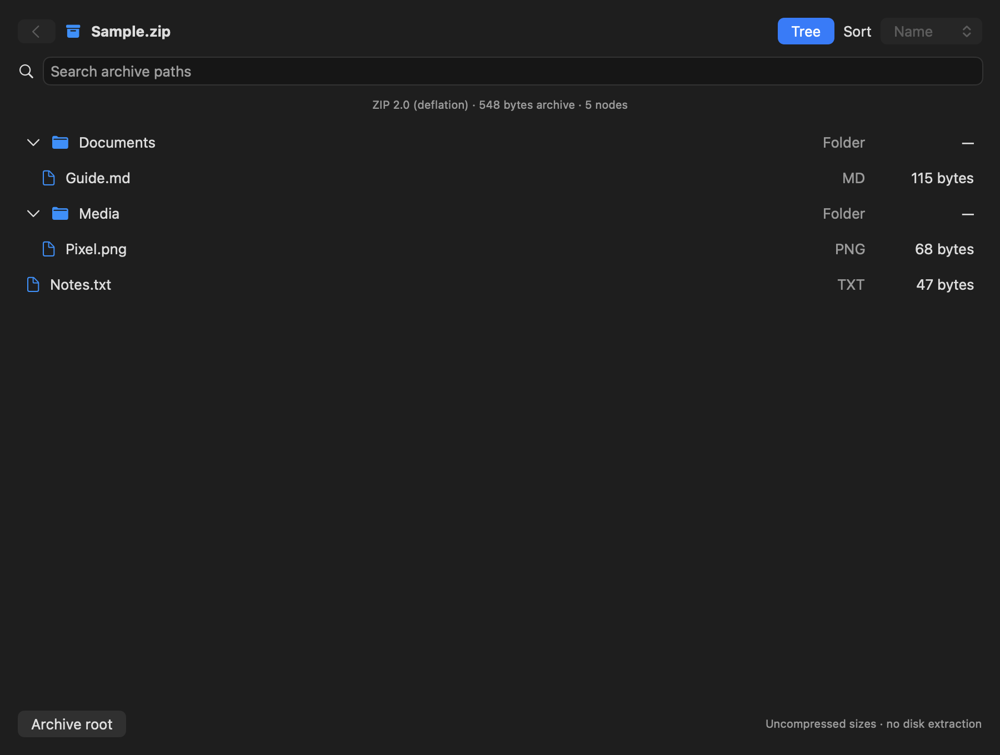
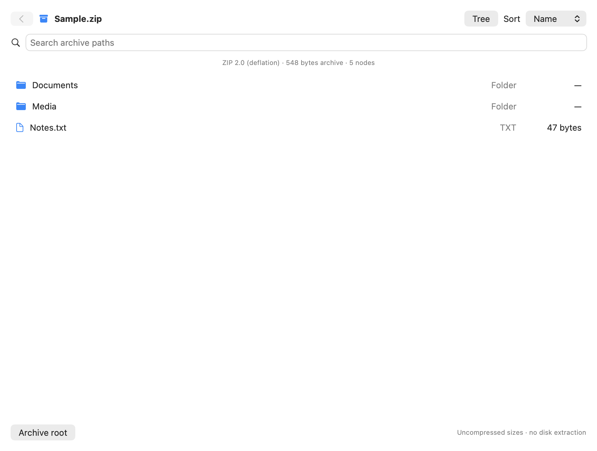
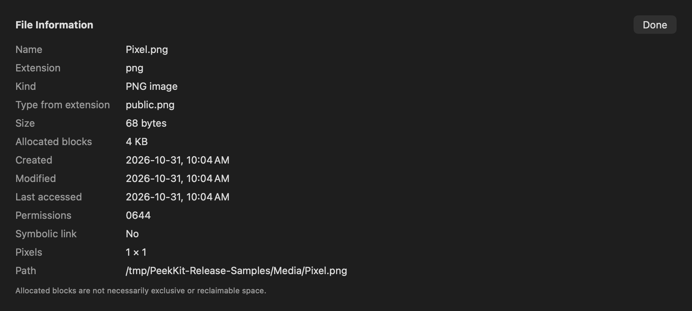
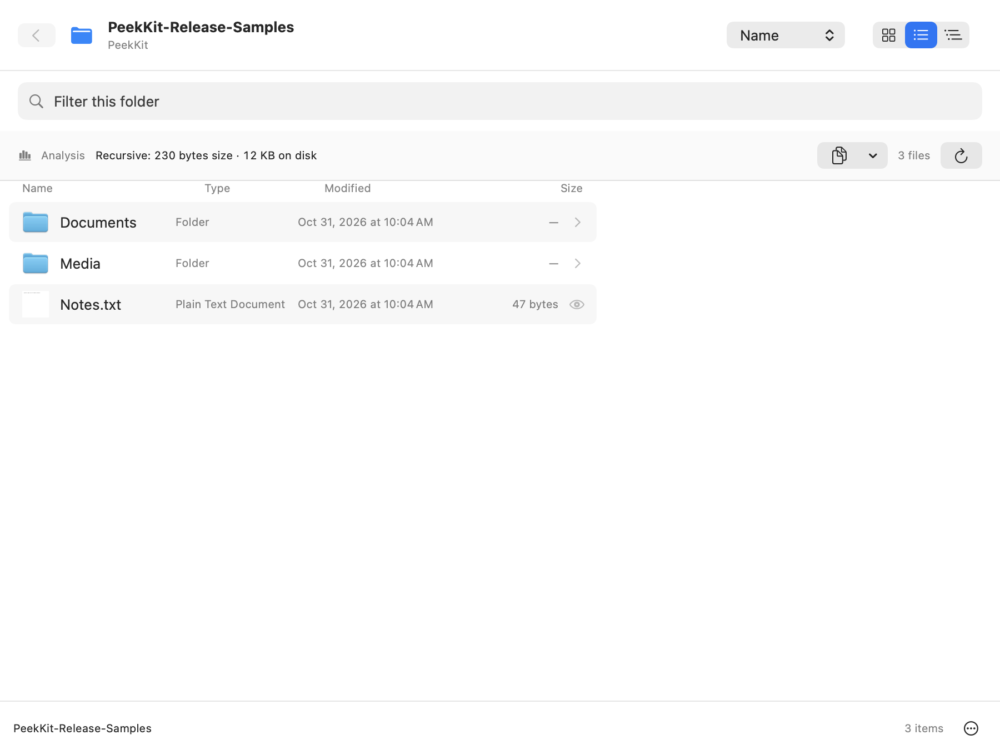
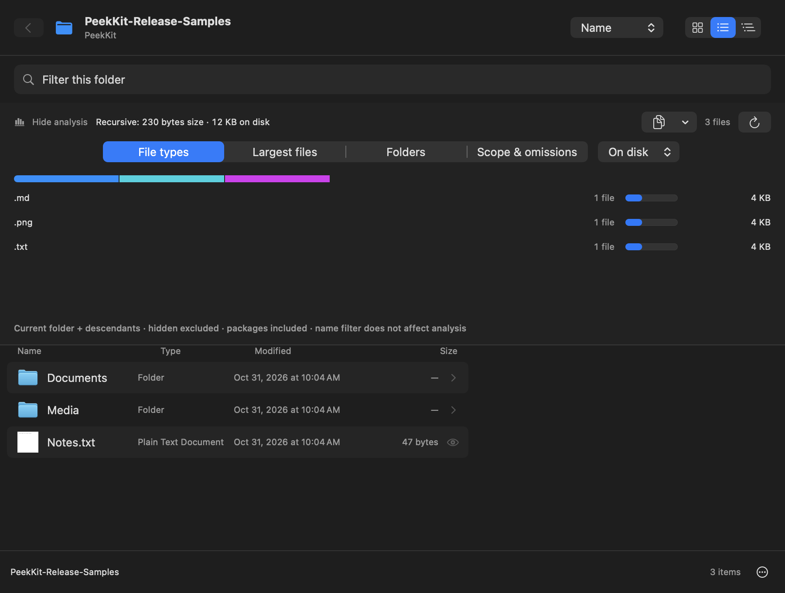
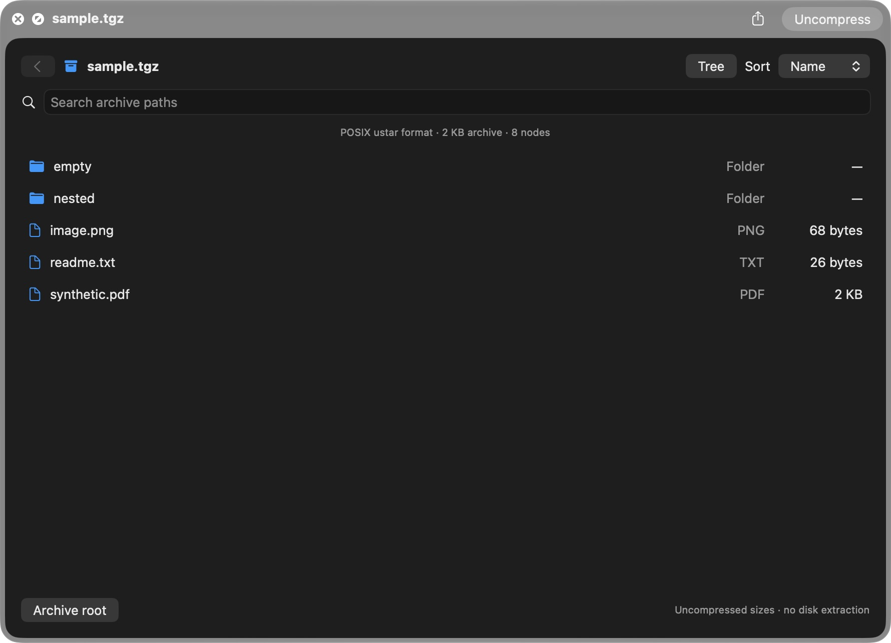
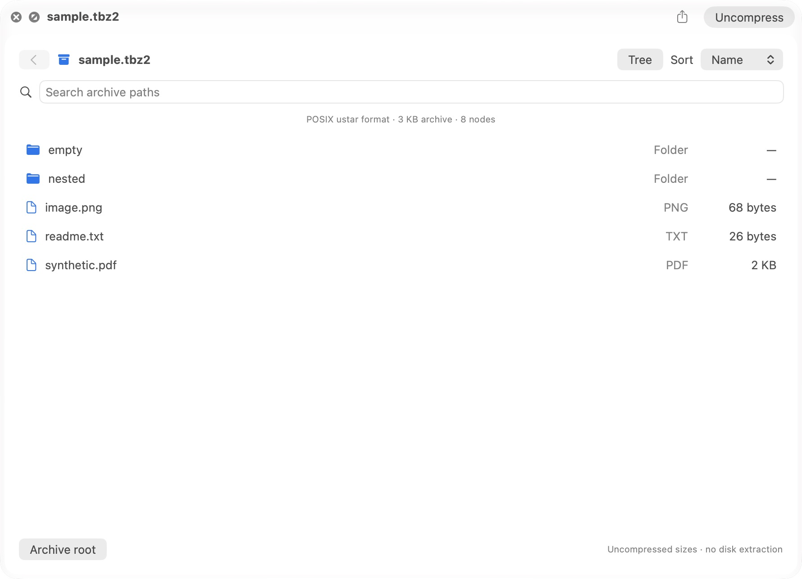
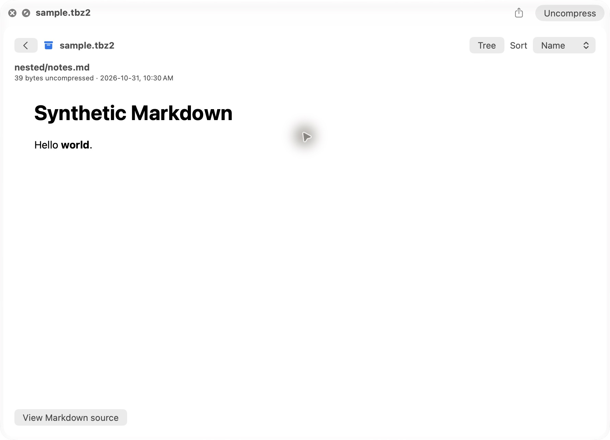
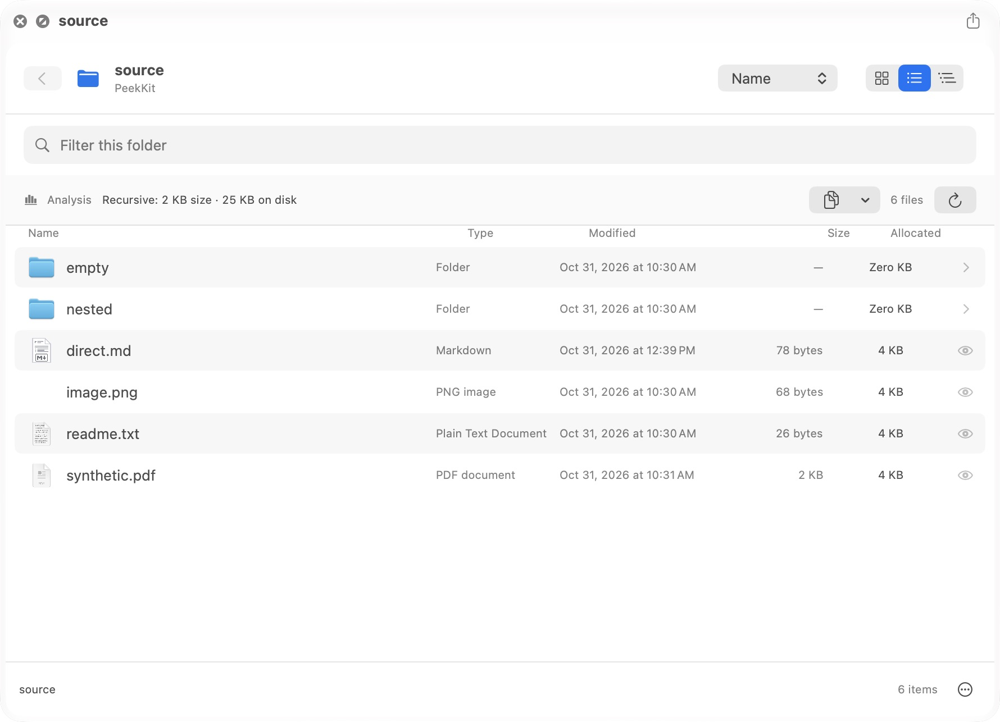
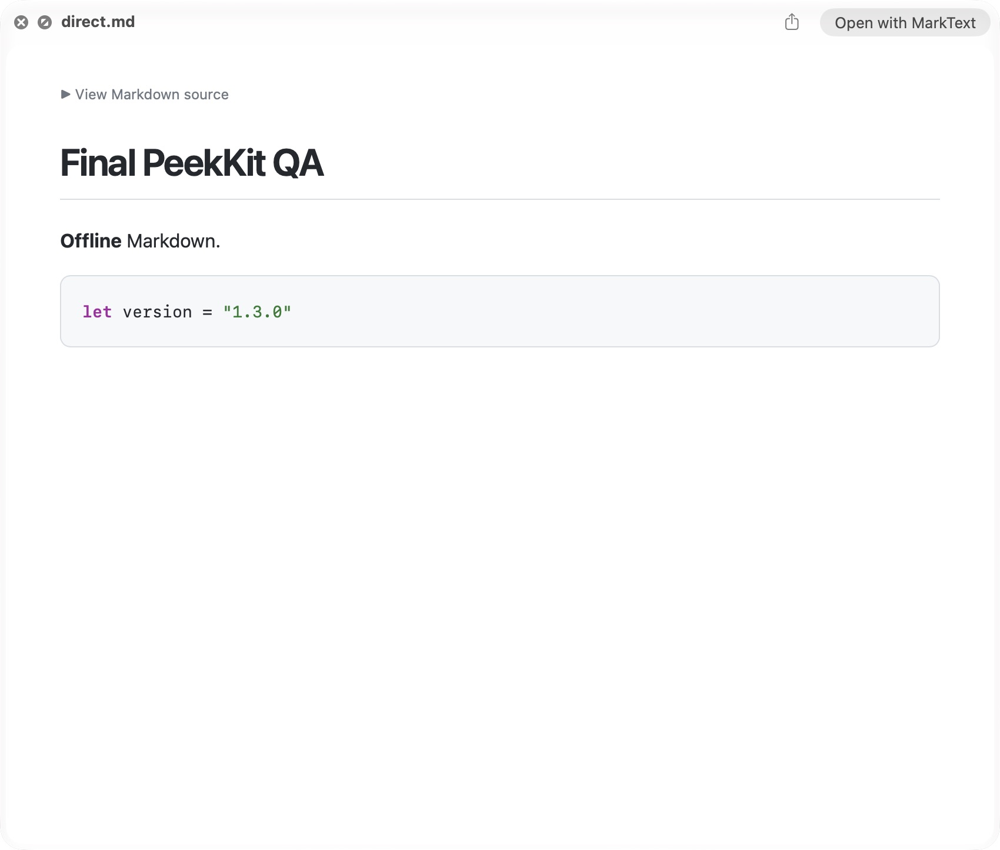

# PeekKit 1.3.0 release candidate validation

Status: **stable source release validation**. Builds target Apple Silicon/macOS 14+. Local environment: Apple M5, 10 logical processors, macOS 27.2 (26B123). Other OS versions/Intel are not integration claims.

## Architecture and build

ArchiveReader uses raw fixed-window GZip/BZip2 filtering before bounded TAR preflight; ZIP local/central preflight forbids unapproved codecs and oversized metadata. See [ARCHIVES.md](ARCHIVES.md) for actual budgets and cooperative deadline semantics. A separate XPC helper was considered; it would require additional IPC/signing/lifecycle work and would not automatically impose memory limits. This candidate instead reduces the native parser input surface before use. Public system libarchive and header BSD notices/provenance remain unchanged.

FolderEntry caches lstat allocation/creation/access metadata on the listing worker. FolderOrdering supports these fields plus extension. FolderBrowser persists optional columns with AppStorage and horizontally scrolls wide lists. No metadata reads occur in row rendering. FileInspection reads resident images/PDFs at most 8 MB for dimensions/page count. Archive Markdown at most 128 KB uses the existing escaped/sanitized offline body/native attributed-text path with safe link handling; archive-relative resources are never resolved.

Source build requires Xcode, no paid credentials or package manager:

```sh
./Tests/registration.sh
./Tests/run.sh
./Tests/archive.sh
./Tests/browser.sh
./build.sh
./Tests/content.sh
./Tools/test-renderer.sh
```

All scripts must pass. CI builds host and both extensions from a clean checkout and executes the same six suites. Default signing is ad-hoc; this is not notarization. Diagnostic snapshot flags render actual app content using synthetic inputs and are not Finder interaction automation.

## Automated results

158 passed / 0 failed: analysis 28, browser/inspector/ordering 35, content/export/security 20, renderer/lifecycle 28, archive 37, registration 10. Reports: [analysis](validation/1.3/analysis.json), [browser](validation/1.3/browser.json), [content](validation/1.3/content.json), [renderer](validation/1.3/renderer.json), [archive](validation/1.3/archive.json).

Added cases cover mismatched ZIP headers, CRC corruption, TAR checksum/conflict errors, truncated compressed streams, oversized PAX metadata, a compressed header bomb, 5,000-entry TAR, 8 MiB highly compressible ZIP, repeated previews and cancellation of an active scan. Existing sparse/hard-link/cloud-policy/descriptor/lifecycle/Markdown security tests remain. This is deterministic regression testing, not fuzzing or proof of general memory safety.

## Scoped performance observations

The archive runner records its own wall time and getrusage peak RSS, excluding compiler memory. RSS includes all archive tests, including rejecting the 129 MiB header-bomb fixture, and is not per-preview RSS or a hard cap. Warm local single-run measurements; no before/after speedup claim:

```json
{
  "cancellationSeconds": 2.045833389274776e-05,
  "largeTar5000Seconds": 0.023807874997146428,
  "largeZip8MiBSeconds": 0.002582458342658356,
  "os": "Version 27.2 (Build 26B123)",
  "peakRSSBytes": 240730112,
  "processors": 10,
  "twentyZipPreviewsSeconds": 0.001265333325136453
}
```

The browser runner retains its 20,000-entry cached-presentation microbenchmark; it excludes painting and initial worker sort. Full-app sampled RSS, slow/cloud providers and long-duration resource leakage remain unverified.

## Actual screenshots

These are real NSHostingView/app content snapshots from the built standalone reader, using synthetic files. Some view states are selected by diagnostic flags. They are not mockups, screenshots of Finder Space, a keyboard interaction test or a VoiceOver audit.







## Final Finder validation — corrected registration

The independent QA report found real TGZ/TBZ2 icon fallbacks in a635327. The minimal two-line fix adds `org.gnu.gnu-zip-tar-archive` and `public.tar-bzip2-archive`; they identify concrete compressed-TAR types, while the old plist only declared their gzip/bzip2 parents. The patch was reviewed/applied, committed as 73a5d25, rebuilt from a clean clone, and temporarily installed at /Applications/PeekKit.app with the production identifiers. A byte-verified original 1.2 app and ZIP were preserved before replacement. Both extensions registered from that production path. No security protections were disabled.

The final corrected code passed **158 checks / 0 failures**: analysis 28, browser/inspector/ordering 35, content/export/security 20, renderer/lifecycle 28, archive 37, registration 10. The registration suite checks all seven folder/archive content types, consistent 1.3.0 build 6 versions, native Quick Look declaration and sandbox/no-network configuration. Source code is unchanged after the clean test except release documentation/evidence.

| Actual Finder Space workflow | Final result |
| --- | --- |
| Stored ZIP, Deflate ZIP, TAR | Browser and expected synthetic entries displayed |
| TGZ, TBZ2, `.tar.gz`, `.tar.bz2` | Browser displayed with expected entries; original icon fallback fixed |
| Tree expansion/collapse, directory entry, Back/root | Exercised with native controls |
| Path search and Size sort | Filter field changed via AX; expected row and descending file sizes observed |
| Archive image/PDF/text/Markdown | Image/PDF detail displayed; Markdown rendered and source toggle changed actual content |
| Folder Grid/List/Tree, analysis | Expected entries, totals and distribution appeared |
| Inspector sheets | Image showed 1×1 pixels; PDF showed 1 page; Done/Escape returned to preview |
| Configurable columns | Allocated enabled in Folder options, visible after preview close/reopen |
| Direct Markdown extension | Heading, code highlighting and source expansion displayed |
| Empty/corrupt archive recovery | Explicit empty/error states; later previews remained responsive |
| 15,001-node ZIP, repeated/rapid close/reopen | Correct node count and normal subsequent preview; no stale-target symptom observed |
| Light/dark | Real Finder layouts captured; original Auto appearance restored |

Immediate Space open/close/reopen was exercised. The native parser completes quickly on these fixtures, so the UI test did not establish that close occurred mid-decode; active cancellation/resource cleanup are instead covered by harness tests. Native keyboard focus is host-dependent: arrows can change Finder selection and Return may act on Finder rather than the preview. This route was **not** reported as a passing keyboard-only audit. Visible native buttons and AX actions work; model navigation regressions pass. VoiceOver speech, complete tab order, real cloud providers, other macOS versions, clean-machine installation and a long-duration stress audit remain unverified. No broad accessibility certification is claimed.

### Real Finder evidence

Unlike the standalone snapshots above, these are captures of the actual Finder Quick Look panel from the corrected installation:







The independent QA's original NO-GO applied to the uncorrected candidate, not to this fixed source tree. Its incomplete matrix was treated as evidence to extend, not as blanket release approval. The corrected supported-format paths and principal user flows above were retested before the stable source release decision. Known keyboard/accessibility/environment limits remain disclosed rather than being asserted as complete.

After testing, the original 1.2 installation was restored byte-identically (executable SHA-256 94093200d8ab009318e8952ceeb211b5a3f323e4cc3bd81de2262c596e262f6c), signature checked, and only its two extensions remained registered. The released 1.3 source does not imply an automatic local upgrade.
